# E-Rapor SMK — Dokumentasi Teknis Tahap 1

## 1. Analisis Kebutuhan

### 1.1 Aktor
| Aktor | Deskripsi |
|---|---|
| Admin | Pengelola sistem & data akademik, validasi/penerbitan rapor |
| Guru Mata Pelajaran | Input nilai, deskripsi capaian, pengiriman nilai |
| Wali Kelas | Rekap nilai, catatan, monitoring kelengkapan, pengajuan rapor |
| Kepala Sekolah | Validasi akhir (via Admin otorisasi) |

### 1.2 Kebutuhan Fungsional (ringkas)
- Autentikasi & RBAC (backend enforced)
- CRUD data master dengan search/filter/pagination
- Pembagian tugas guru (teaching_assignments)
- Pengaturan penilaian fleksibel (assessment_components, KKTP, bobot)
- Input nilai spreadsheet + autosave draft + import/export Excel
- Deskripsi capaian berbasis learning outcomes
- Workflow pengiriman nilai (draft→siap→terkirim→dikunci→revisi)
- Rekap nilai wali kelas (read-only)
- Catatan, prestasi, ekstrakurikuler
- Monitoring kelengkapan rapor
- Preview & cetak rapor A4 PDF (single/massal) + arsip
- PKL & UKK
- Audit log, activity log

### 1.3 Kebutuhan Non-Fungsional
- Bahasa Indonesia UI
- Responsive (desktop/tablet/mobile)
- Keamanan: CSRF, hashing, transaction, scoped access
- Performa: indeks, eager loading, pagination
- Auditability: activity_logs

## 2. Arsitektur Aplikasi

```
Client (Blade+Tailwind+Alpine) 
  -> Laravel Router (web.php) 
  -> Middleware (auth, role, permission)
  -> Controllers (Admin/Teacher/Homeroom)
  -> FormRequests (validation)
  -> Policies (authorization)
  -> Services (business logic, transactions)
  -> Eloquent Models
  -> MySQL
```

- **Service layer** untuk logika bisnis (AssessmentService, ReportCardService, WorkflowService).
- **Form Requests** untuk validasi.
- **Policies** untuk otorisasi per resource.
- **Events/Listeners** untuk audit log & notifikasi (opsional).
- **Jobs** untuk cetak PDF massal (queue).

## 3. ERD

```mermaid
erDiagram
  USERS ||--o| TEACHERS : has
  USERS ||--o| STUDENTS : has
  USERS }o--|| ROLES : belongs
  ROLES }o--o{ PERMISSIONS : via role_permissions
  DEPARTMENTS ||--o{ CLASSES : has
  ACADEMIC_YEARS ||--o{ SEMESTERS : has
  ACADEMIC_YEARS ||--o{ CLASSES : has
  CLASSES }o--|| DEPARTMENTS : belongs
  CLASSES }o--|| TEACHERS : homeroom
  SUBJECTS }o--o{ DEPARTMENTS : optional
  CURRICULA ||--o{ LEARNING_OUTCOMES : has
  LEARNING_OUTCOMES ||--o{ LEARNING_OBJECTIVES : has
  LEARNING_OUTCOMES }o--|| SUBJECTS : belongs
  TEACHING_ASSIGNMENTS }o--|| TEACHERS : has
  TEACHING_ASSIGNMENTS }o--|| SUBJECTS : has
  TEACHING_ASSIGNMENTS }o--|| CLASSES : has
  TEACHING_ASSIGNMENTS }o--|| ACADEMIC_YEARS : has
  TEACHING_ASSIGNMENTS }o--|| SEMESTERS : has
  HOMEROOM_ASSIGNMENTS }o--|| TEACHERS : has
  HOMEROOM_ASSIGNMENTS }o--|| CLASSES : has
  HOMEROOM_ASSIGNMENTS }o--|| ACADEMIC_YEARS : has
  HOMEROOM_ASSIGNMENTS }o--|| SEMESTERS : has
  ASSESSMENT_COMPONENTS }o--|| SUBJECTS : optional
  ASSESSMENT_COMPONENTS }o--|| CURRICULA : optional
  ASSESSMENT_SCORES }o--|| STUDENTS : has
  ASSESSMENT_SCORES }o--|| SUBJECTS : has
  ASSESSMENT_SCORES }o--|| TEACHERS : has
  ASSESSMENT_SCORES }o--|| CLASSES : has
  ASSESSMENT_SCORES }o--|| ACADEMIC_YEARS : has
  ASSESSMENT_SCORES }o--|| SEMESTERS : has
  ASSESSMENT_SCORES }o--|| ASSESSMENT_COMPONENTS : has
  STUDENT_ATTENDANCES }o--|| STUDENTS : has
  STUDENT_ATTENDANCES }o--|| CLASSES : has
  STUDENT_ATTENDANCES }o--|| ACADEMIC_YEARS : has
  STUDENT_ATTENDANCES }o--|| SEMESTERS : has
  STUDENT_ACHIEVEMENTS }o--|| STUDENTS : has
  STUDENT_ACHIEVEMENTS }o--|| ACADEMIC_YEARS : has
  STUDENT_ACHIEVEMENTS }o--|| SEMESTERS : has
  EXTRACURRICULARS ||--o{ STUDENT_EXTRACURRICULARS : has
  STUDENT_EXTRACURRICULARS }o--|| STUDENTS : has
  STUDENT_EXTRACURRICULARS }o--|| ACADEMIC_YEARS : has
  STUDENT_EXTRACURRICULARS }o--|| SEMESTERS : has
  TEACHER_DESCRIPTIONS }o--|| STUDENTS : has
  TEACHER_DESCRIPTIONS }o--|| SUBJECTS : has
  TEACHER_DESCRIPTIONS }o--|| TEACHERS : has
  TEACHER_DESCRIPTIONS }o--|| ACADEMIC_YEARS : has
  TEACHER_DESCRIPTIONS }o--|| SEMESTERS : has
  REPORT_CARDS }o--|| STUDENTS : has
  REPORT_CARDS }o--|| CLASSES : has
  REPORT_CARDS }o--|| ACADEMIC_YEARS : has
  REPORT_CARDS }o--|| SEMESTERS : has
  REPORT_CARDS ||--o{ REPORT_CARD_SUBJECTS : has
  REPORT_CARDS ||--o{ REPORT_CARD_NOTES : has
  REPORT_CARDS ||--o{ REPORT_CARD_APPROVALS : has
  REPORT_CARD_SUBJECTS }o--|| SUBJECTS : has
  REPORT_CARD_APPROVALS }o--|| USERS : approver
  INTERNSHIPS }o--|| STUDENTS : has
  INTERNSHIPS ||--o{ INTERNSHIP_ASSESSMENTS : has
  COMPETENCY_EXAMS }o--|| STUDENTS : has
  COMPETENCY_EXAMS }o--|| SUBJECTS : has
  ACTIVITY_LOGS }o--|| USERS : has
```



## 4. Struktur Tabel MySQL (ringkas + indeks)

### users
- id PK
- name, email (unique), password
- role_id FK roles
- is_active boolean
- timestamps
- index: email, role_id

### roles
- id PK, name, slug (unique), description

### permissions
- id PK, name, slug (unique), group

### role_permissions
- role_id FK, permission_id FK, PK(role_id,permission_id)

### teachers
- id PK, user_id FK unique, nip unique, name, gender, phone, address, photo, timestamps
- index: nip, user_id

### students
- id PK, user_id FK unique nullable, nis unique, nisn unique, name, gender, birth_date, address, class_id FK nullable, timestamps
- index: nis, nisn, class_id

### departments
- id PK, code unique, name, description

### classes
- id PK, department_id FK, academic_year_id FK, name, level (X/XI/XII), homeroom_teacher_id FK teachers nullable, timestamps
- index: department_id, academic_year_id, name
- unique(department_id, academic_year_id, name)

### academic_years
- id PK, name unique, start_date, end_date, is_active

### semesters
- id PK, academic_year_id FK, name (Ganjil/Genap), is_active
- unique(academic_year_id, name)

### subjects
- id PK, code unique, name, department_id FK nullable, is_active

### curricula
- id PK, name, academic_year_id FK, description

### learning_outcomes
- id PK, curriculum_id FK, subject_id FK, code, description
- index: curriculum_id, subject_id

### learning_objectives
- id PK, learning_outcome_id FK, code, description

### teaching_assignments
- id PK, teacher_id FK, subject_id FK, class_id FK, academic_year_id FK, semester_id FK, hours
- unique(teacher_id, subject_id, class_id, academic_year_id, semester_id)
- index: teacher_id, class_id, subject_id

### homeroom_assignments
- id PK, teacher_id FK, class_id FK, academic_year_id FK, semester_id FK
- unique(class_id, academic_year_id, semester_id)

### assessment_components
- id PK, name, type (formatif/sumatif/praktik/proyek), weight decimal, subject_id FK nullable, curriculum_id FK nullable, is_active
- index: subject_id, type

### assessment_scores
- id PK, student_id FK, subject_id FK, teacher_id FK, class_id FK, academic_year_id FK, semester_id FK, component_id FK, score decimal(5,2), note text nullable
- unique(student_id, subject_id, component_id, academic_year_id, semester_id)
- index: student_id, subject_id, class_id, teacher_id, (academic_year_id, semester_id)

### student_attendances
- id PK, student_id FK, class_id FK, academic_year_id FK, semester_id FK, date, status (H/S/I/A), note
- index: student_id, class_id, date

### student_achievements
- id PK, student_id FK, academic_year_id FK, semester_id FK, title, description, level

### extracurriculars
- id PK, name unique, description

### student_extracurriculars
- id PK, student_id FK, extracurricular_id FK, academic_year_id FK, semester_id FK, score, description
- unique(student_id, extracurricular_id, academic_year_id, semester_id)

### teacher_descriptions
- id PK, student_id FK, subject_id FK, teacher_id FK, academic_year_id FK, semester_id FK, description
- unique(student_id, subject_id, academic_year_id, semester_id)

### report_cards
- id PK, student_id FK, class_id FK, academic_year_id FK, semester_id FK, status (draft/submitted/validated/issued/locked), issued_at, locked_at, issued_by FK users nullable
- unique(student_id, academic_year_id, semester_id)
- index: class_id, status

### report_card_subjects
- id PK, report_card_id FK, subject_id FK, final_score decimal, description text
- unique(report_card_id, subject_id)

### report_card_notes
- id PK, report_card_id FK, note_type (wali_kelas/kepala_sekolah), content text

### report_card_approvals
- id PK, report_card_id FK, approver_id FK users, status (pending/approved/rejected), note, approved_at
- index: report_card_id, approver_id

### internships
- id PK, student_id FK, company_name, start_date, end_date, supervisor, grade

### internship_assessments
- id PK, internship_id FK, aspect, score, note

### competency_exams
- id PK, student_id FK, subject_id FK, score, note, exam_date

### activity_logs
- id PK, user_id FK nullable, action, model_type, model_id, ip_address, user_agent, created_at
- index: user_id, (model_type, model_id), created_at

## 5. Foreign Keys & Cascade Policy
- users.role_id -> roles.id (restrict)
- teachers.user_id -> users.id (cascade delete)
- students.user_id -> users.id (set null), class_id -> classes.id (set null)
- classes.department_id -> departments.id (restrict), academic_year_id -> academic_years.id (restrict), homeroom_teacher_id -> teachers.id (set null)
- semesters.academic_year_id -> academic_years.id (cascade)
- teaching_assignments.* -> restrict on delete (prevent orphan)
- assessment_scores.* -> restrict
- report_cards.* -> restrict; issued_by -> users.id (set null)
- Semua FK menggunakan InnoDB, utf8mb4.

## 6. RBAC

### Roles
- admin, guru, wali_kelas (slug)

### Permissions (contoh grup)
- users.* , students.* , teachers.* , departments.* , classes.* , subjects.* , academic_years.* , semesters.* , curricula.* , assignments.* , assessments.settings.* , assessments.input.* , reports.* , pkl.* , ukk.* , logs.view

### Matrix (ringkas)
| Permission | Admin | Guru | Wali Kelas |
|---|---|---|---|
| data master CRUD | ✓ | — | — |
| pembagian tugas | ✓ | — | — |
| pengaturan penilaian | ✓ | — | — |
| input nilai (kelas diampu) | — | ✓ | — |
| deskripsi capaian | — | ✓ | — |
| kirim nilai | — | ✓ | — |
| rekap nilai (baca) | ✓ | — (kelas sendiri) | ✓ |
| catatan/prestasi/ekskul | — | — | ✓ |
| monitoring rapor | ✓ | — | ✓ |
| validasi/penerbitan rapor | ✓ | — | — |
| cetak rapor | ✓ | — | ✓ |
| PKL/UKK | ✓ | ✓ (input) | — (baca) |
| audit log | ✓ | — | — |

### Scoping Data
- Guru: hanya kelas/subject dari teaching_assignments aktif.
- Wali kelas: hanya kelas dari homeroom_assignments aktif.
- Admin: semua.

## 7. Indeks Strategis
- assessment_scores: composite (student_id, subject_id, academic_year_id, semester_id); (class_id, subject_id)
- teaching_assignments: (teacher_id), (class_id)
- report_cards: (class_id, status), (student_id, academic_year_id, semester_id)
- students: (class_id), (nis)
- activity_logs: (created_at), (user_id)

## 8. Workflow Status

### Nilai (assessment_scores group)
- draft → siap_kirim → terkirim → dikunci → perlu_revisi

### Rapor (report_cards.status)
- draft → diajukan → divalidasi → diterbitkan → dikunci (reopen butuh otorisasi admin)

## 9. Catatan Implementasi
- Semua query wajib scope academic_year_id & semester_id aktif (global scope via middleware/session).
- Nilai semester lama tidak berubah karena composite key menyertakan academic_year & semester.
- Cetak PDF massal via queue job.
- Autosave nilai via endpoint draft (idempotent).

## 10. Database Engine: PostgreSQL

- Primary DB: PostgreSQL 18 (driver `pgsql`).
- Laravel `.env`: `DB_CONNECTION=pgsql`, port 5432.
- Use JSONB for flexible metadata (`activity_logs.metadata`, `system_settings.value`).
- Migrations use portable Blueprint types; avoid MySQL-specific SQL.
- Transactions via DB::transaction.
- Indexes: B-tree default; consider GIN for JSONB search.
- Enum columns implemented as varchar + check constraints by Laravel on pgsql.

